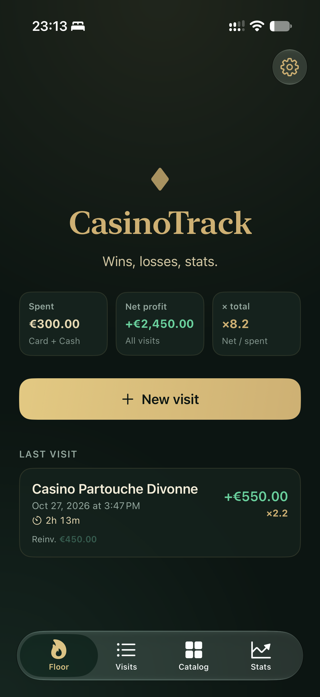
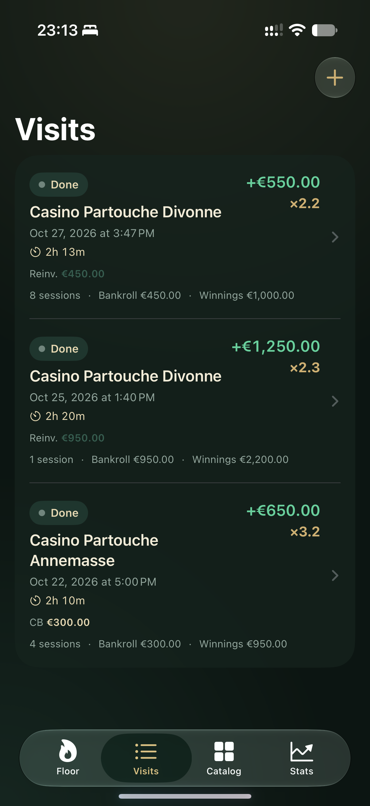
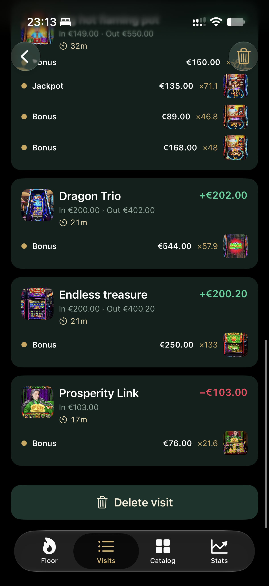
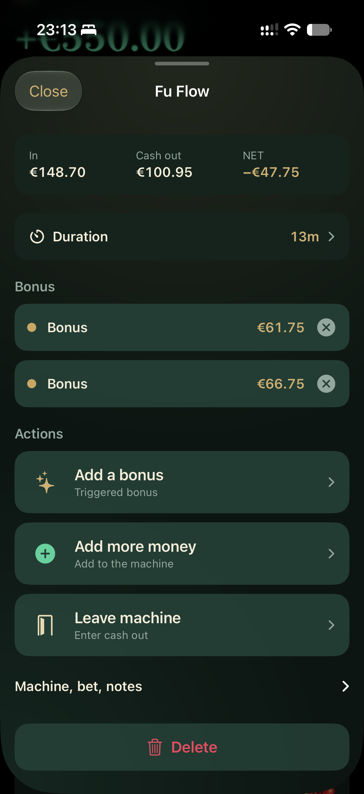
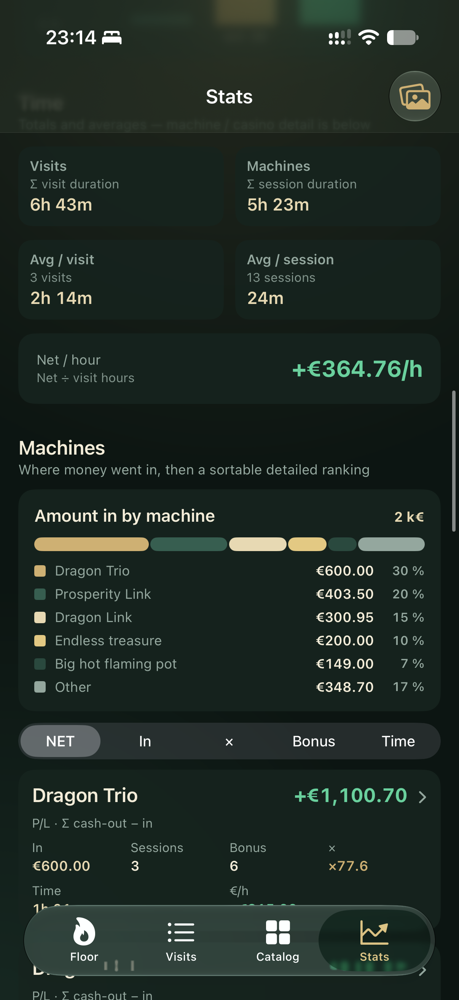
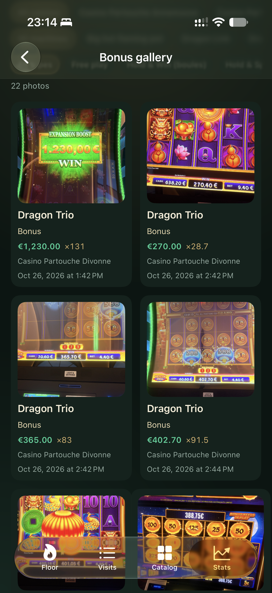

# CasinoTrack

**Private casino session tracker for iPhone.** Built with SwiftUI and SwiftData — green felt, gold accents, fully offline on the floor.

Log visits, machines, CB vs cash budget, and bonus photos without relying on a network. Your data lives on device (SwiftData), with optional CloudKit when a capable Apple Developer account provisions iCloud.

---

## Features

- **Floor** — live visit dashboard: start a sortie, jump into sessions, keep budget and bonuses at hand
- **Visits & sessions** — track machine time, buy-ins, cash-outs, and net / multiplier
- **Budget** — separate **CB**, **liquide**, and **réinvesti** entries; capital and profit/loss stay honest
- **Bonuses** — typed events (Yummy, Upsized, Spicy, Boost, Rise, Catch, …) with camera / library photos
- **Catalogue** — casinos, machines, favorites; edit or add on the go
- **Stats & charts** — bankroll over time, machine rankings, bonus breakdown, casino filters
- **Bonus gallery** — photo grid of your wins
- **Offline-first** — SwiftData local store; CloudKit private DB when entitlements allow, otherwise local-only fallback

---

## Screenshots

Floor dashboard — totals, last visit, and start a new sortie:



Visits list — history of sorties with net and multiplier:



Visit detail — sessions, bonuses, and machine net:



Session editor — in / cash out, bonuses, and leave machine:



Stats — time spent, net per hour, and machine rankings:



Bonus gallery — photo grid of triggered bonuses:



---

## Requirements

| | |
| --- | --- |
| Xcode | 16+ (recommended) |
| iOS | 17.0+ |
| Device | iPhone (device family phone) |
| Tooling | [XcodeGen](https://github.com/yonaskolb/XcodeGen) (`brew install xcodegen`) |

A free **Personal Team** is enough to run on your own iPhone. Paid Team + iCloud capability unlocks CloudKit sync between devices on the same Apple ID.

---

## Build & run

```bash
cd ios
xcodegen generate
open CasinoTrack.xcodeproj
```

In Xcode:

1. Select the **CasinoTrack** target → **Signing & Capabilities**
2. Enable **Automatically manage signing** and pick your Team
3. Choose your iPhone as the run destination → **Run**

**First install (Personal Team):** on the device go to  
*Settings → General → VPN & Device Management* → trust your developer certificate.

On first launch, bundled seed data (`Resources/SeedData/seed.json` + photos) imports casinos, machines, bonus types, and historical visits so the app is usable immediately.

---

## Project structure

```
.
├── README.md
├── .gitignore
├── img/                         # app screenshots for this README
└── ios/
    ├── project.yml              # XcodeGen spec
    ├── CasinoTrack.xcodeproj    # generated / committed project
    └── CasinoTrack/
        ├── App/                 # entry + root tabs
        ├── Features/            # Floor, Visit, History, Catalog, Stats, Settings
        ├── Models/              # SwiftData models
        ├── Services/            # seed, stats, photos, money math
        ├── Components/          # money pad, camera, shared UI
        ├── Theme/               # felt / gold design tokens
        ├── Resources/SeedData/  # seed.json + machine/bonus photos
        ├── Assets.xcassets
        └── CasinoTrack.entitlements
```

Regenerate the Xcode project after editing `project.yml`:

```bash
cd ios && xcodegen generate
```

---

## Notes

- Bundle ID: `net.papamica.casinotrack`
- UI language: French (domain terms: sortie, CB, liquide, …)
- No server, no accounts, no analytics in this repo — just the native app
